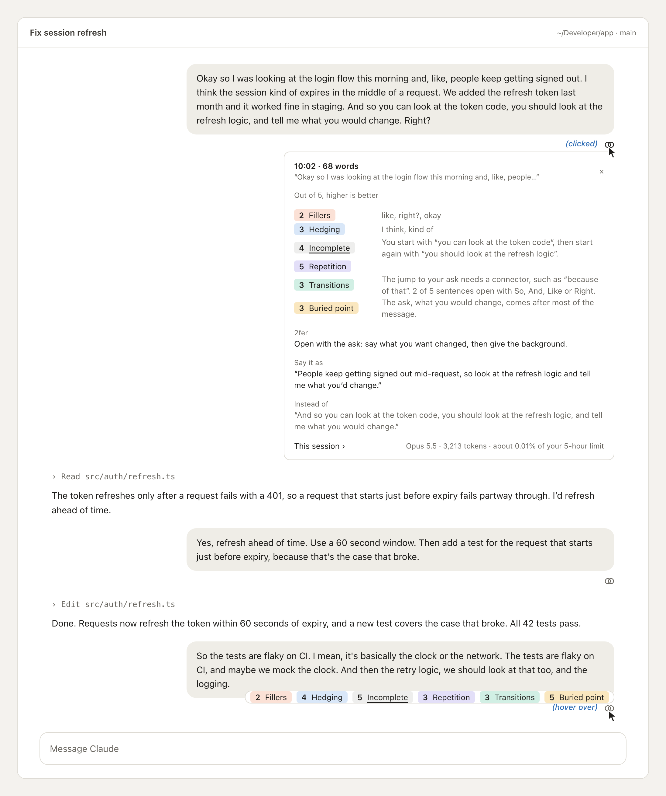
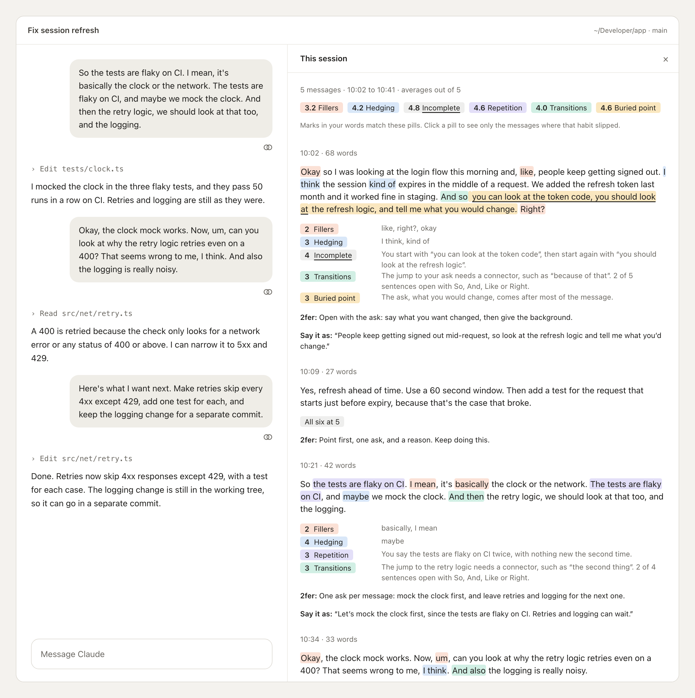

# 2fer

Speaking practice while you work. If you dictate your messages to Claude Code, 2fer turns each one into practice. A small mark under the message opens a card that scores how you said it, out of 5, on six habits. The card also names the one change to make next time.

The name is the idea: every message does two things. It gets your work done, and it trains you to speak more clearly.

## What it looks like

These images are renderings of 2fer's own drawing code, with made-up messages and a made-up week. They aren't screenshots, so spacing can differ a little in the app, and the pointer and its blue labels are there only to show what was clicked or hovered over.

When you send a dictated message, a small two-ring mark, ⚭, appears under it, with "scoring…" beside it until the model's scores arrive. Nothing else is added to the conversation. In a terminal, the mark is the word **2fer**.

Hover over the mark for a quick look at every score, floating over the end of your message, and nothing moves. Click the mark to open the full card right under the message. Click again, or ×, to close it. Both color each habit as the session pane does.



**This session ›** opens a pane beside the chat with every message you've dictated in the session, in order:
- Each habit is marked where it showed up in your own words. Fillers, hedges, a repeated point, an unclear jump, and the sentence that carries your main point each get their own color. Restarts are underlined.
- Under each message, every habit that scored under 5 gets a line: its pill, carrying its mark, and the note that explains it. Then come the 2fer and "Say it as". A message with nothing to fix gets a word of praise instead.
- The pills at the top give the session's averages and carry the same marks, so they double as the legend. They stay in place as you scroll. Click one to see only the messages where that habit slipped, and click it again to see them all.



`/2fer` opens your week beside the chat. It covers the last seven days:
- **This week's scores:** one card per habit. Pick a card, and the rest of the view follows that habit.
- **Week by week:** a chart of the habit against your other habits in gray. You can step back through earlier weeks or switch to a table.
- **Messages per week:** a bar chart of how many messages you dictated each week.
- **What kept happening:** the habit's most common pattern, with examples from your messages.
- **The habit's words:** for a habit counted in code, its most common words this week against last.
- **Your best message** and the 2fer that kept coming back.


## Install

At the prompt of a Claude Code terminal session:

```
/plugin install 2fer --marketplace gurinder-raju/2fer
```

Answer `y` to add the marketplace, then press Enter to install it for your user. Or, from a shell:

```bash
claude plugin install 2fer --marketplace gurinder-raju/2fer
```

`/plugin` doesn't run in the Claude desktop app. There, click **+** next to the prompt box, then **Plugins**, then **Add marketplace** with `gurinder-raju/2fer`, then **Add plugin**. A plugin installed for your user from a terminal also runs in the desktop app.

2fer is built on Claude Code's plugin hooks API, which is in early access. It was tested on Claude Code 2.1.309.

## Use it

- Dictate as you normally would. Each message of 15 words or more gets a note. Hover over its ⚭ mark to see its scores, or click it to open the card under the message.
- `/2fer session`, or **This session ›** on any card, opens this session's messages beside the chat.
- `/2fer` opens your week beside the chat.
- `/2fer settings` opens the settings, where you choose the model. `/2fer model haiku` does the same from the prompt.

## The six habits

2fer scores the habits I wanted to work on. Each is named for what goes wrong, and scored out of 5, where higher is better. Code counts fillers and hedging, which costs nothing; the model judges the other four.

| Habit | What it catches | Scored by |
|---|---|---|
| Usage of fillers | like, you know, I mean, basically, actually, right?, an opening "Okay" | code |
| Hedging | I think, maybe, probably, I guess, kind of, a little bit, something like that | code |
| Incomplete sentences | dropping an explanation partway and starting again a different way, without saying so | model |
| Unnecessary repetition | the same point or ask made again later, without adding anything; a summary at the end is fine | model |
| Unclear transitions | moving to the next idea without saying how it relates, or starting a list and not finishing it; an idea that comes to you as you speak is fine | model |
| Buried point | the main point or request waiting behind a long setup; a little context or courtesy first is fine, and so is a point that comes to you as you speak | model |

People think as they talk, and the model is told so. It counts a late point, an abrupt turn or a repeat only when it's a fault in how you said something you already had in mind. A point you reached by reasoning aloud, a turn to an idea that just came to you, and a summary at the end aren't slips.

To change what a habit looks for, edit `hooks/catalog.ts`.

## Models and your limit

Each note is one request to the model you choose. Claude Code makes it with the same account as your session, so it counts toward your plan's usage limits, or your API bill if you use an API key. The request carries that one message and nothing else: no conversation history and no tools. Your conversation with Claude is unaffected.

| Model | What a note uses |
|---|---|
| Opus 5.5 (default) | about 3,000 tokens for 50 words and 4,000 for 300, or roughly 0.01 to 0.03% of a 5-hour limit on Pro |
| Sonnet 5.5 | about half of Opus |
| Haiku 5.5 | about a fortieth of Opus |
| No model | nothing: fillers and hedging only, with no rewrite or 2fer |

Each request asks the model to think at medium effort before it scores, and that thinking is part of those tokens. To change the effort, edit `EFFORT` in `hooks/register.tsx`.

Each opened note shows the tokens it used and about how much of your 5-hour limit that was, and the weekly view adds them up for the week.

The share is an estimate. A plan reports only how full the whole window is, in whole points, not what each request took. So each note reads the window, 2fer works out what a point is worth from what your session spends while the window moves, and it weighs the note the same way, at API list prices. Your plan may weigh tokens differently. Other sessions and claude.ai fill the same window, which can make the share read high. It appears once the window has moved two points between notes in a session, and never with an API key, which has no such window.

The weekly view sums up habits judged by the model, such as Buried point, with one more model request when you pick that habit, about the size of a note. The answer is kept, so the request runs again only when that week's notes change.

## What it reviews, and what it keeps

- **Which messages:** ones you send yourself that read as dictated prose. They can come from a terminal, the desktop app, or a phone over Remote Control. "Dictated prose" means 15 words or more, capitalized the way dictation writes, and not code or a paste. Slash commands and messages from other plugins are skipped.
- **Typing:** 2fer can't tell dictation from careful typing, so a typed message that reads like dictated prose gets a note too.
- **What the model sees:** only that one message.
- **What's stored:**
  - **Within a session:** notes and the session pane's copy of your messages are kept in the session's own state.
  - **For the weekly trend, for 26 weeks:** a small record of each note, with its scores, the habit words it counted and where they fell, the 2fer and the token use. This record holds none of your words.
  - **For the weekly examples, for 14 days:** a separate record of a few of your words.
    - The message's start, up to 200 characters, for "best message".
    - A few words either side of each habit 2fer found.
    - The model's notes, which can quote you.

    After 14 days these records are deleted.
  - **For the share of your limit:** one number, what a point of your 5-hour limit is worth. It's kept across sessions and replaced as 2fer learns more.
  - **Where it all lives:** the records and your settings are in a JSON file under your Claude Code configuration folder.

## Development

```bash
claude plugin validate .
claude plugin test .
```

To run 2fer from a clone, start Claude Code with `claude --plugin-dir <path to the clone>`, or name the folder in `CLAUDE_CODE_PLUGIN_DIRS`.

| File | What it holds |
|---|---|
| `hooks/register.tsx` | the hooks: the note under each message, `/2fer`, and the two panes |
| `hooks/speech.ts` | what code works out: which messages to review, the counts, the model's reply, the note's lines, and the trend |
| `hooks/catalog.ts` | the six habits and the models |
| `hooks/rubric.ts` | the model's instructions, built from the habits in the catalog |
| `types/index.d.ts` | what 2fer keeps in session state |
| `tests/2fer.test.tsx` | the tests |
| `images/` | the renderings in this README and the plugin listing |

## License

MIT
