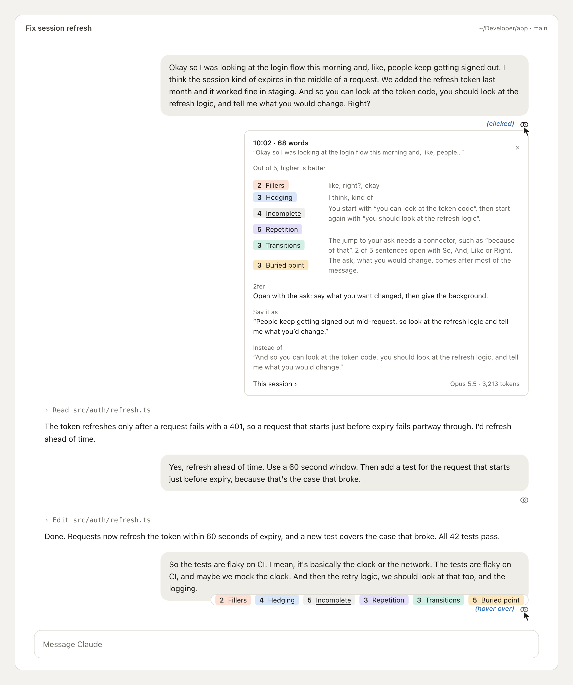
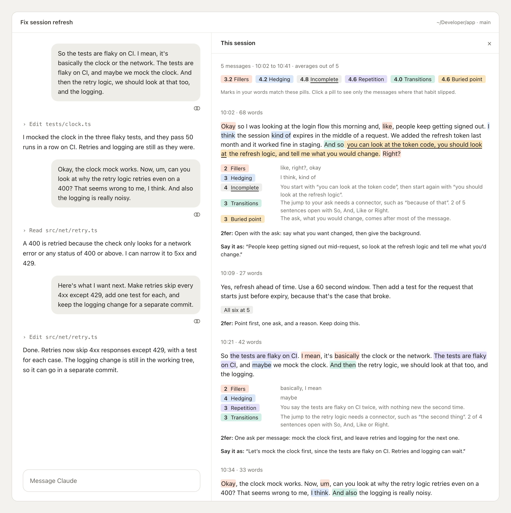

# 2fer

Speaking practice while you work. If you dictate your messages to Claude Code, 2fer turns each one into practice. A small mark under the message opens a card that scores how you said it, out of 5, on six habits. The card also names the one change to make next time.

The name is the idea: every message does two things. It gets your work done, and it trains you to speak more clearly.

2fer tries to score only what you said. It can't see how a message was entered, so it cuts pastes and links, skips messages that read as typed, and has the scoring model check the rest. [How it finds dictated messages](#how-it-finds-dictated-messages) has the details.

## What it looks like

These images are renderings of 2fer's own drawing code, with made-up messages and a made-up week. They aren't screenshots, so spacing can differ a little in the app, and the pointer and its blue labels are there only to show what was clicked or hovered over.

When you send a dictated message, a small two-ring mark, ⚭, appears under it, with "scoring…" beside it until the model's scores arrive. Nothing else is added to the conversation. In a terminal, the mark is the word **2fer**.

Hover over the mark for a quick look at every score, floating over the end of your message, and nothing moves. Click the mark to open the full card right under the message. Click again, or ×, to close it. Both color each habit as the session pane does.



**This session ›** opens a pane beside the chat with every message you've dictated in the session, in order:
- Each habit is marked where it showed up in your own words. Fillers, hedges, a repeated point, an unclear jump, and the sentence that carries your main point each get their own color. Restarts are underlined.
- Under each message, every habit that scored under 5 gets a line: its pill, carrying its mark, and the note that explains it. Then come the 2fer and "Say it as". A message with nothing to fix gets a word of praise instead.
- The pills at the top give the session's averages and carry the same marks, so they double as the legend. They stay in place as you scroll. Click one to see only the messages where that habit slipped, and click it again to see them all.



`/2fer` opens your week beside the chat. It covers the last seven days:
- **This week's scores:** one card per habit. Pick a card, and the rest of the view follows that habit.
- **Week by week:** a chart of the habit against your other habits in gray. You can step back through earlier weeks or switch to a table.
- **Messages per week:** a bar chart of how many messages you dictated each week.
- **What kept happening:** the habit's most common pattern, with examples from your messages.
- **The habit's words:** for a habit counted in code, its most common words this week against last.
- **Your best message** and the 2fer that kept coming back.

Earlier weeks keep their scores and counts. Your words go after seven days, so the examples, your best message and the 2fers show only for the latest week.


## Before you install

- **It uses your limit.** Each note is one request to the model you choose, on your plan or API bill. Sonnet 5.5 is the default. See [Models and your limit](#models-and-your-limit).
- **It's English only.** Messages in other languages get no note.
- **It needs plain dictation.** 2fer scores the text your dictation tool writes. A tool that cleans up as you speak, such as Wispr Flow, removes the fillers and restarts 2fer looks for, so your scores would read too high. A tool that writes everything in lowercase gets few notes.
- **It keeps a few of your words.** They stay on your machine for seven days, with scores and counts for 26 weeks. See the [privacy page](PRIVACY.md). `/2fer forget` deletes them.
- **It's early.** It was built for one speaker and used daily in the Claude desktop app. A terminal and the IDE extensions have only been tested in code.

## Install

At the prompt of a Claude Code terminal session:

```
/plugin install 2fer --marketplace gurinder-raju/2fer
```

Answer `y` to add the marketplace, then press Enter to install it for your user. Or, from a shell:

```bash
claude plugin install 2fer --marketplace gurinder-raju/2fer
```

`/plugin` doesn't run in the Claude desktop app. There, click **+** next to the prompt box, then **Plugins**, then **Add marketplace** with `gurinder-raju/2fer`, then **Add plugin**. A plugin installed for your user from a terminal also runs in the desktop app.

In a terminal, the install asks which model to start with. The first session then says what 2fer does and what it uses.

2fer is built on Claude Code's plugin hooks API, which is in early access. It needs Claude Code 2.1.271 or later, and was tested on 2.1.309.

## Use it

- Dictate as you normally would. Each message of 15 words or more gets a note. Hover over its ⚭ mark to see its scores, or click it to open the card under the message.
- **Ignore** on a card takes that message out of the session and your week.
- `/2fer session`, or **This session ›** on any card, opens this session's messages beside the chat.
- `/2fer` opens your week beside the chat.
- `/2fer settings` opens the settings, where you choose the model. `/2fer model haiku` does the same from the prompt.
- `/2fer pause` stops notes in every session, until `/2fer resume`.
- `/2fer forget` deletes everything 2fer has kept, apart from your settings. It asks you to confirm first.
- `/2fer help` lists the commands.

## The six habits

2fer scores the habits I wanted to work on. Each is named for what goes wrong, and scored out of 5, where higher is better. Code counts fillers and hedging, which costs nothing; the model judges the other four.

| Habit | What it catches | Scored by |
|---|---|---|
| Usage of fillers | like, you know, I mean, basically, actually, right?, an opening "Okay" | code |
| Hedging | I think, maybe, probably, I guess, kind of, a little bit, something like that | code |
| Incomplete sentences | dropping an explanation partway and starting again a different way, without saying so | model |
| Unnecessary repetition | the same point or ask made again later, without adding anything; a summary at the end is fine | model |
| Unclear transitions | moving to the next idea without saying how it relates, or starting a list and not finishing it; an idea that comes to you as you speak is fine | model |
| Buried point | the main point or request waiting behind a long setup; a little context or courtesy first is fine, and so is a point that comes to you as you speak | model |

People think as they talk, and the model is told so. It counts a late point, an abrupt turn or a repeat only when it's a fault in how you said something you already had in mind. A point you reached by reasoning aloud, a turn to an idea that just came to you, and a summary at the end aren't slips.

Code can't read every "like" for meaning. It skips ones such as "I like" and "looks like", but a phrase such as "apps like Slack" counts as a filler.

To change what a habit looks for, edit `hooks/catalog.ts`.

## Models and your limit

Each note is one request to the model you choose. Claude Code makes it with the same account as your session, so it counts toward your plan's usage limits, or your API bill if you use an API key. The request carries that one message and nothing else: no conversation history and no tools. Your conversation with Claude is unaffected.

| Model | What a note uses |
|---|---|
| Opus 5.5 | about 3,000 tokens for 50 words and 4,000 for 300 |
| Sonnet 5.5 (default) | about half of Opus |
| Haiku 5.5 | about a fortieth of Opus |
| No model | nothing: fillers and hedging only, with no rewrite or 2fer |

Each request asks the model to think at medium effort before it scores, and that thinking is part of those tokens. To change the effort, edit `EFFORT` in `hooks/register.tsx`.

If the model doesn't give a usable answer, the note keeps the fillers and hedging that code counted, and says the model didn't answer.

Each opened note shows the tokens it used, and the weekly view adds them up for the week.

The weekly view sums up habits judged by the model, such as Buried point, with one more model request when you pick that habit, about the size of a note. The answer is kept, so the request runs again only when that week's notes change.

## How it finds dictated messages

Nothing tells 2fer how a message was entered, so it works from the message itself, in four steps.

1. **Who sent it.** Only messages you send yourself count, from a terminal, the desktop app, or a phone over Remote Control. Slash commands, scheduled tasks and messages from other plugins are skipped.
2. **What nobody said.** Pastes the app marks, links, and long passages in double quotes are cut. They aren't counted, scored, sent to the model or kept, and a … shows where one was. The app marks only long pastes, so a short paste stays in.
3. **Whether the rest looks spoken.** What's left needs 15 to 900 words, mostly plain words in English, with the capitals dictation writes: a capital first word and a capital "I". An "uh" or "um" counts as speech whatever the capitals. Code, tags, lists, Markdown, words in parentheses, a space before a colon, transcript timestamps and styled letters all rule a message out.
4. **Whether the model agrees.** The scoring model decides whether the message reads as spoken. One that clearly doesn't gets no note, though its tokens are still used. With no model, this step doesn't run.

These steps are judgment calls, so some careful typing gets through, mostly short, conversational messages. In a test on one person's messages, the model flagged 2 of 50 that passed step 3, and both read as written. It caught 12 of 25 typed messages cleaned up to look like dictation.

**Ignore** on a card takes a message out of the session and your week, and the weekly view's last line counts what was ignored. Use `/2fer pause` when you're mostly typing.

## What it sends, and what it keeps

- **What the model sees:** only what's left of that one message.
- **What's stored:**
  - **Within a session:** notes and the session pane's copy of your messages are kept in the session's own state.
  - **For the weekly trend, for 26 weeks:** a small record of each note: its scores, how often it used each habit word on 2fer's fixed lists and where they fell, and the token use. Apart from those listed words, this record holds none of what you said.
  - **For the latest week's examples, for seven days:** separate records of a few of your words, and of what the model said about them.
    - The message's start, up to 200 characters, for "best message".
    - A few words either side of each habit 2fer found.
    - The model's notes and its 2fer, which can quote you.
    - Any weekly pattern the model summed up from those notes.

    The first session to start after seven days deletes these records.
  - **Where it all lives:** the records and your settings are in a JSON file under your Claude Code configuration folder.

## Development

```bash
claude plugin validate .
claude plugin test .
```

To run 2fer from a clone, start Claude Code with `claude --plugin-dir <path to the clone>`, or name the folder in `CLAUDE_CODE_PLUGIN_DIRS`.

| File | What it holds |
|---|---|
| `hooks/register.tsx` | the hooks: the note under each message, `/2fer`, and the two panes |
| `hooks/speech.ts` | what code works out: which messages to review, the counts, the model's reply, the note's lines, and the trend |
| `hooks/catalog.ts` | the six habits and the models |
| `hooks/rubric.ts` | the model's instructions, built from the habits in the catalog |
| `types/index.d.ts` | what 2fer keeps in session state |
| `tests/2fer.test.tsx` | the tests |
| `images/` | the renderings in this README and the plugin listing |

## License

MIT
